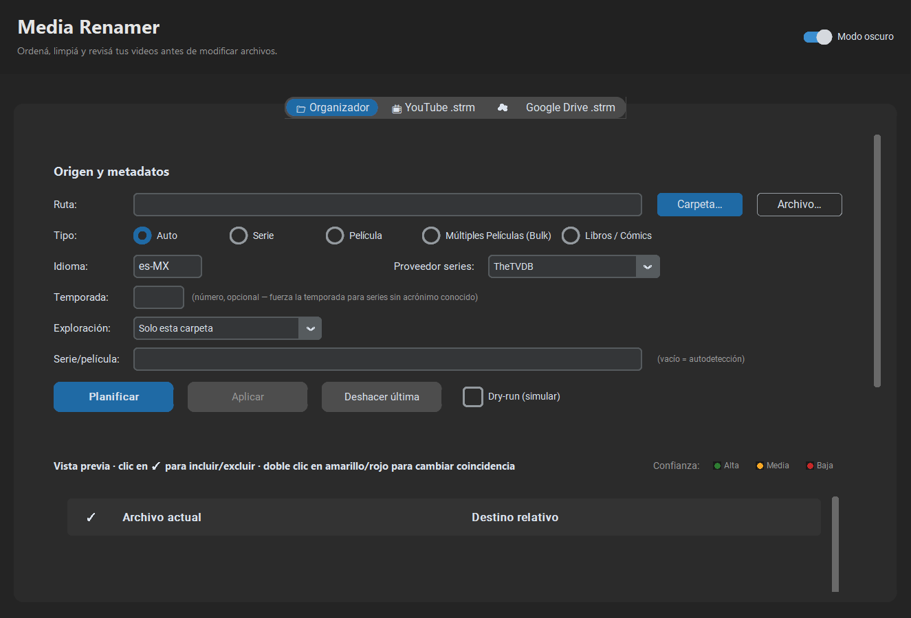
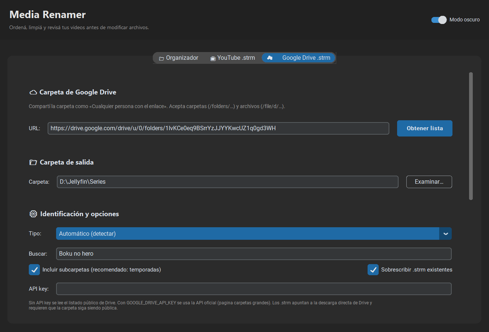
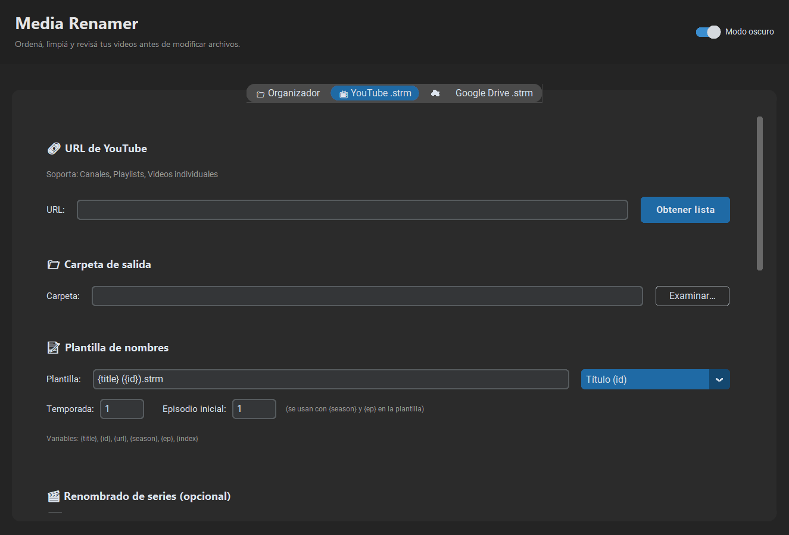

# Media Renamer

Organizador de series, películas, libros y cómics. Planifica los cambios antes de
mover nada, muestra la confianza de cada coincidencia y permite deshacer la última
operación.

## Capturas

### Organizador



### Google Drive `.strm`



### YouTube `.strm`



## Series y películas

- Series: TMDb o TheTVDB (`THETVDB_API_KEY` opcional).
- Películas: TMDb.
- Limpieza local de nombres sin consultar metadatos.

## Libros y cómics

Formatos reconocidos:

- Libros: `.epub`, `.mobi`, `.azw`, `.azw3`, `.pdf`, `.fb2`, `.djvu`, `.lit`
- Cómics: `.cbz`, `.cbr`

Metadatos: Open Library y, como respaldo, Google Books. Open Library no necesita
clave. Si organizás muchos libros, podés configurar `GOOGLE_BOOKS_API_KEY` en
`.env` para evitar el límite de consultas de la API pública.

### Estructura para Jellyfin

Los libros quedan con la estructura recomendada por Jellyfin:

```text
Books/
  Bernardo Stamateas/
    Gente tóxica (2018)/
      Gente tóxica.pdf

Comics/
  Plastic Man (1944)/
    Plastic Man #002 (1944).cbz
```

La carpeta `Books` o `Comics` no se duplica si ya elegís una carpeta con ese
nombre. Si un libro no aparece en Open Library/Google Books, se conserva el nombre
limpio y, cuando existe `(Autor)` en el archivo, se usa como carpeta de autor. La
vista previa marca esos casos con confianza baja.

### GUI

En la pestaña **Organizador**, elegí **Libros / Cómics**. Podés seleccionar una
carpeta completa o un archivo. La opción **Incluir subcarpetas (lote)** procesa
cada carpeta con libros. El doble clic sobre una fila con candidatos permite
elegir otra edición.

### CLI

```powershell
# Planificar y aplicar libros de una carpeta
python -m media_renamer "I:\Libros\B3rN4rSt" --type book

# Sólo simular
python -m media_renamer "I:\Libros\B3rN4rSt" --type book --dry-run

# Un libro concreto
python -m media_renamer "I:\Libros\Libro.epub" --type book
```

También está el menú interactivo:

```powershell
python -m media_renamer --cli
```

## Interfaz gráfica

Abrí la GUI con `python -m media_renamer --gui` o con `media-renamer-gui-modern`. Si
`customtkinter` no está instalado, se abre la versión clásica, que no incluye las
pestañas de YouTube ni de Google Drive.

## Google Drive `.strm`

La pestaña **☁️ Google Drive .strm** (o el modo `--drive`) crea archivos `.strm`
que apuntan a videos alojados en Google Drive. Después puede renombrarlos con TMDb o
TheTVDB para que Jellyfin los identifique como serie o película.

Requisitos:

- La carpeta (o el archivo) debe estar compartida como **«Cualquier persona con el
  enlace»**. Los `.strm` no pueden transportar credenciales, así que las carpetas
  privadas no se pueden reproducir de esta forma.
- Si la carpeta es muy grande, podés configurar `GOOGLE_DRIVE_API_KEY` en `.env` para
  usar la API oficial de Drive. Sin clave se lee el listado público de la página.

La URL que queda dentro del `.strm` es la descarga directa de Google
(`drive.usercontent.google.com`), que admite `Range` y permite avanzar/retroceder en
Jellyfin, VLC o Kodi. Google puede limitar temporalmente la descarga de un archivo
muy compartido; en ese caso el reproductor mostrará un error hasta que se libere la
cuota.

### GUI

1. Pegá el enlace de la carpeta y pulsá **Obtener lista**.
2. Elegí la carpeta raíz de la biblioteca en **Carpeta de salida**.
3. En **Tipo**, dejá **Automático** o elegí **Serie** / **Películas**.
4. Pulsá **Generar archivos .strm**. Si elegiste identificar con metadatos, el plan
   aparece en la pestaña **Organizador** para revisarlo y aplicar.

Las subcarpetas `S1`, `Season 01`, `Temporada 2`, etc. se usan para numerar los
episodios. `Especiales`, `Specials`, `OVA` se mapean a `Season 00`.

### CLI

```powershell
# Generar .strm y planificar el renombrado como serie
python -m media_renamer `
  --drive "https://drive.google.com/drive/folders/1IvKCe0eq9BSrrYzJJYYKwcUZ1q0gd3WH" `
  --drive-output "D:\Jellyfin\Series" `
  --drive-mode tv `
  --query "Boku no Hero Academia"

# Sólo generar los .strm, sin consultar metadatos
python -m media_renamer --drive "https://drive.google.com/drive/folders/…" `
  --drive-output "D:\Jellyfin\Series" --drive-mode none

# Simular el renombrado sin mover archivos
python -m media_renamer --drive "…" --drive-output "…" --drive-mode tv --dry-run
```

## Configuración

Copiá `.env.example` a `.env` y completá `TMDB_API_KEY` y `TMDB_BEARER`. Las claves
de TheTVDB y Google Books son opcionales. `DEFAULT_LANGUAGE` define el idioma de
búsqueda (por defecto `es-MX`).

## Seguridad

El programa genera un plan y pide confirmación antes de mover archivos. Usá
`--dry-run` para revisar sin cambios. La última operación se puede deshacer desde
la GUI o con `--undo`.
